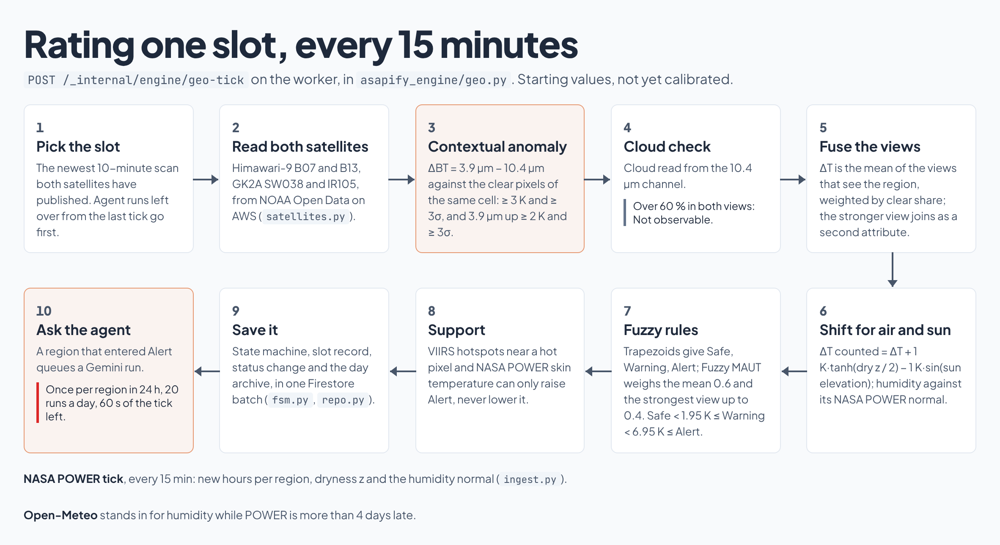
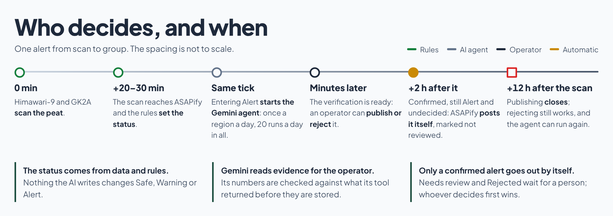

# ASAPify backend

Risk engine and operator API for the `KRL-TEAM-PROJECT/ktp-asapify-fe` frontend, deployed to Cloud Run in Jakarta.

> **Frozen on 18 October 2026.** Development has stopped; this repository and its docs describe the system as it
> stands. Only fixes that keep the deployed service running belong here. Known limitations are listed below.
> The tag `freeze-2026-10-18` marks the final state of `main`; `freeze-2026-10-16` marks the state submitted on
> 16 October (live image `gh-f40381a` then). What changed between the two is listed in
> [CLOUDSHELL.md](docs/CLOUDSHELL.md).

## How it works


Every 15 minutes this service reads the newest scan of Himawari-9 and GK2A and rates 65 peat regions of Sumatra and
Kalimantan. Rules alone set Safe, Warning or Alert. On Alert a Gemini agent built with the Agent Development Kit reads
NASA FIRMS hotspots, two NASA GIBS images and the weather for the operator; it cannot change a status. The operator
publishes or rejects, and published alerts go to the ASAPify Telegram group. A confirmed alert nobody decides on
within 2 hours goes out by itself, marked as not reviewed.

## On Google Cloud


Project `hack2skill-510921`, Jakarta (`asia-southeast2`); Gemini runs on the `global` endpoint. One image runs both
Cloud Run services: `asapify-api` (public and operator API, Telegram webhook) and the private worker
`asapify-notify` (satellite and POWER ticks, agent runs, Telegram posts, the recovery sweep). Setup:
[GCP.md](docs/GCP.md), [NOTIFICATIONS.md](docs/NOTIFICATIONS.md), [CLOUDSHELL.md](docs/CLOUDSHELL.md).


## Inside the backend



The geo tick in `asapify_engine/geo.py`, step by step; [ENGINE.md](docs/ENGINE.md) has every rule and number.




All diagrams come from one slide deck, [docs/diagrams/asapify-diagrams.html](docs/diagrams/asapify-diagrams.html).
Download it and open it in a browser; arrow keys move between its 28 slides (the API by caller, the Firestore
collections, the scheduled jobs, the code map and the data sources included), and `?export=1` gives the light view
without controls that these images were taken from.

## Shipping


`.github/workflows/deploy-backend.yml` runs on every merge to `main` that changes the API, engine or agent code.
Settings, IAM, queues and schedules stay as `gcp/` set them; a merge changes only the image.

## Notifications

Alerts go to the team's Telegram group: the ASAPify bot posts every alert an operator publishes there, and anyone
who wants the information joins the group from the app's public join page. A Firestore outbox, Cloud Tasks with OIDC
and a recovery sweep carry each message. A fresh deploy starts in `dry_run`; production runs `live` since
`gcp/telegram-live.sh`. See [NOTIFICATIONS.md](docs/NOTIFICATIONS.md).
There are no personal subscriptions, inboxes or push messages.

## State at the freeze, 18 October 2026

| Component | Status |
|---|---|
| FastAPI `/api/v1`: health, regions, day archive, agent, decisions, operator access (plus CAPTCHA self-registration for the judging period, GCP.md), notifications | Implemented; reads the engine's Firestore documents. The pixel grid / night / cluster API (15 Oct) and the never-built alert list/close endpoints (16 Oct) were removed |
| Authentication | Firebase ID token, verified email, custom claim `role=operator`; revocation checked |
| Public read-only | `/api/v1/public/regions`, `/regions/{id}` (24 h at most), `/days`, `/days/{date}`: the map, region detail and day archive for everyone, without operator emails or decision notes, and without actions. Cached by the Hosting CDN (`s-maxage` 120 s, past days 1 day) so public traffic barely reaches Firestore |
| Operator decision | Firestore transaction: decision, alert reservation, audit; a second decision is refused. Publishing ends 12 h after the verified slot; a CONFIRMED verification nobody decided on within 2 h goes out by itself, labelled, while its region is still ALERT (`asapify_api/publication.py`) |
| Telegram | The bot posts every published alert in the team's Telegram group(s); an operator links a group from the Admin page. No personal chats. Live: published alerts reach the linked group. Since 18 Oct the backend keeps the team group's invite link, so the public join page lists it before any operator saves one |
| Cloud Run + GCS + Firestore + Artifact Registry | Live in `hack2skill-510921` since 9 Oct. Every merge to `main` that touches the API is tested and deployed by GitHub Actions (see [CLOUDSHELL.md](docs/CLOUDSHELL.md)). Firestore rules released 13 Oct (no direct browser access) |
| Risk engine | Live: 65 peat regions, Himawari-9 + GK2A every 15 minutes (each satellite backs the other up; the clear-weighted mean and, since 17 Oct, the strongest valid view as two Fuzzy MAUT attributes), fuzzy curves shifted by the air's dryness against its two-year NASA POWER normal (taken from the same dates of the years before, also across the new year, since 18 Oct) and by the sun, VIIRS + NASA POWER as support, state machine, audit record per slot, hot pixels and nearby VIIRS per region, a day archive for the map's date picker that keeps ΔT as measured and, since 18 Oct, as counted. See [ENGINE.md](docs/ENGINE.md) |
| Himawari/GK2A decoding | In the engine (`asapify_engine/satellites.py`, satpy), checked against VIIRS on one night slot; the older `pipeline/` code was removed on 15 Oct and stays in git history ([ENGINE.md](docs/ENGINE.md) maps one to the other) |
| ADK/Gemini agent | `geospatial_analyst` on Gemini Enterprise with `fetch_firms_data` (NASA FIRMS) and a visual check of two NASA GIBS images plus the weather at the hot pixel: automatic on entering ALERT (at most once per region in 24 hours) and the Re-verify button, YAML checked before it is stored, hard daily quota |
| Cloud tests with real Firebase/Firestore/Telegram | Proven live: Google sign-in, 401/403, the private worker, satellite data on the map, and an operator publishing an alert that reached the Telegram group |

The engine covers **Sumatra + Kalimantan**: 65 peat regions; the satellites scan every 10 minutes and the engine rates
one slot every 15, grouped by WIB day.

Statuses are `SAFE` < `WARNING` < `ALERT`, plus `NO_OBSERVABLE` (compact codes `S`, `W`, `A`, `N`).

## Known limitations at the freeze

- **Not calibrated.** Every threshold and weight in `RuleConfig`, `FusionConfig` and `ContextConfig` is an initial
  hypothesis, checked against VIIRS on one night slot only (ENGINE.md, Validation). A utility is a match score and
  the agent's confidence its own score; neither is a fire probability.
- **Not an operational early-warning system.** Latency and reach in the field were never measured; Telegram's
  `accepted` means the provider took the message, not that anyone read it, and delivery is not exactly-once.
- **Scope.** Sumatra and Kalimantan only; night streaks, neighbour support and a per-pixel history are not used.
- **History.** Slots stored before a rule change keep the result they had; nothing is recomputed. The rules of
  16 October (shifted curves, no day or single-satellite cap, 15-minute cycle) apply from their deployment on;
  `tools/backtest_rules.py` shows how they would have rated the stored slots.
- **Agent.** NASA FIRMS hotspots plus daytime GIBS imagery (a night observation is checked against the afternoon
  before it), with a hard quota of 20 runs a day. Images never confirm a fire on their own.
- **Unreviewed alerts.** A verification the agent CONFIRMED that no operator decided on within 2 hours goes to the
  group by itself while its region is still ALERT, labelled as not reviewed by an operator. A team that wants every
  message checked has to decide within that time; NEEDS_MANUAL_REVIEW and REJECTED never go out on their own.
- **Dryness.** NASA POWER is 2-3 days late; while it is older than 4 days, Open-Meteo is measured against POWER's
  normal instead (two models, flagged in the record).
- **Gaps in the day archive.** A geo tick processes only the newest slot both satellites have published and never
  backfills, so slots can be skipped: 15 Oct holds 86 of 144 slots. With the 15-minute cycle about one 10-minute
  scan slot in three is never rated (at most 96 a day). Until 16 Oct the worker `asapify-notify` also ran out of
  memory on some ticks (17 of 144 returned 503 in the 24 hours to 16 Oct 11:00 UTC); it was raised to 1 GiB on
  16 Oct (revision `asapify-notify-00021`). See ENGINE.md (Cost and limits).

## Data sources

| Data | Used for | Link |
|---|---|---|
| Himawari-9 (JMA), bands 7 and 13, via NOAA Open Data on AWS | Thermal anomaly and cloud, every 10-minute scan | [registry](https://registry.opendata.aws/noaa-himawari/) · [bucket](https://noaa-himawari9.s3.amazonaws.com) |
| GEO-KOMPSAT-2A (KMA), SW038 and IR105, via NOAA Open Data on AWS | The second view of the same peat | [registry](https://registry.opendata.aws/noaa-gk2a-pds/) · [bucket](https://noaa-gk2a-pds.s3.amazonaws.com) |
| NASA FIRMS, VIIRS NOAA-20 / NOAA-21 active fires | Support near a hot pixel and the agent's only tool | [FIRMS](https://firms.modaps.eosdis.nasa.gov/) · [API](https://firms.modaps.eosdis.nasa.gov/api/) |
| NASA GIBS, VIIRS NOAA-20 corrected reflectance | The agent's two images (true colour, false colour SWIR) | [GIBS API docs](https://nasa-gibs.github.io/gibs-api-docs/) · [Worldview](https://worldview.earthdata.nasa.gov/) |
| NASA POWER, hourly skin temperature and humidity | The humidity normal (dryness) and skin-temperature support | [POWER](https://power.larc.nasa.gov/) · [API docs](https://power.larc.nasa.gov/docs/services/api/) |
| Open-Meteo (CC BY 4.0) | Humidity fallback and the weather at the hot pixel for the agent | [open-meteo.com](https://open-meteo.com/) |
| KHG peat hydrological units (KLHK) | The 65 peat regions (`tools/khg/`, built by `tools/build_regions.py`) | [shapefile in this repository](tools/khg/) |
| Gemini on Gemini Enterprise Agent Platform (formerly Vertex AI), Agent Development Kit | The verification agent | [Agent Platform](https://docs.cloud.google.com/gemini-enterprise-agent-platform/) · [ADK](https://google.github.io/adk-docs/) |
| Telegram Bot API | Posting published alerts in the group | [Bot API](https://core.telegram.org/bots/api) |

Live app: https://hack2skill-510921.web.app · frontend: `KRL-TEAM-PROJECT/ktp-asapify-fe`.

## Local

```bash
python3 -m venv .venv
source .venv/bin/activate
pip install -r requirements-dev.txt
python -m pytest -q
uvicorn main:app --host 127.0.0.1 --port 8080
```

`GET /api/v1/health` works without the cloud. Operator endpoints refuse requests without a token.
There is no login bypass, automatic demo seed or synthetic data in this service.
Missing data returns `DATA_NOT_READY`, never a `SAFE` status.

Use the [GCP guide](docs/GCP.md) for deployment and [ENGINE.md](docs/ENGINE.md) for the engine. The image
installs `requirements-api.txt`; `tools/build_regions.py` rebuilds the regions from the KHG peat shapefile in
`tools/khg/`.
